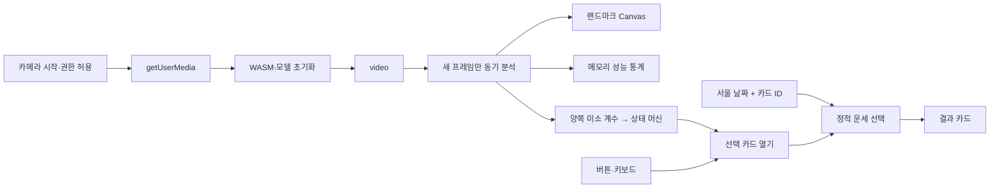

# Architecture V1

## 구성

| 위치                             | 책임                                                        |
| -------------------------------- | ----------------------------------------------------------- |
| `src/App.tsx`                    | 카드 선택, 결과 상태, 카메라 UI, 진단 패널                  |
| `src/components/FortuneCard.tsx` | 운세 결과와 개봉 전 카드 렌더링                             |
| `src/vision/camera.ts`           | getUserMedia, 트랙 정리, 오류 분류                          |
| `src/vision/landmarker.ts`       | 고정 버전 공식 리소스, VIDEO / CPU / 1명 / blendshapes 설정 |
| `src/vision/useFaceCamera.ts`    | 비동기 초기화, 세션 취소, 프레임 루프, 측정, 제스처 연결    |
| `src/vision/draw.ts`             | Canvas 크기·좌표 정합 및 랜드마크 점 렌더링                 |
| `src/lib/smile.ts`               | 독립적인 미소 상태 머신                                     |
| `src/lib/fortune.ts`             | 한국어 콘텐츠, 서울 날짜, 카드별 결정적 선택                |
| `src/lib/performance.ts`         | 최대 120개 추론 표본과 통계                                 |

## 데이터 흐름

얼굴 정보에서 운세 함수로 이어지는 데이터 경로는 없습니다. 미소는 매개변수 없는 `onSmile()` 이벤트만 발생시킵니다. 카드 ID는 라디오 UI에서 선택합니다.

## 상태와 수명

카메라: `idle → permission → loading → running`, 실패 시 `error`. 시작·중지마다 증가하는 세션 ID로 오래된 비동기 결과를 폐기합니다. 종료 후 도착한 MediaStream은 즉시 stop, 모델은 close합니다. 정리 함수는 RAF 취소, 트랙 stop, 모델 close, video 해제, Canvas 지우기를 수행합니다. React StrictMode의 effect 재실행도 고려합니다.

미소: `ready → holding → latched → releasing → ready`. holding 중 임계값 아래로 떨어지면 초기화합니다. latched에서는 미소가 지속되어도 재실행하지 않습니다. releasing에서 다시 웃으면 latched로 돌아갑니다. 얼굴 미감지는 상태와 진행률을 초기화합니다. 프레임이 250ms 이상 끊기면 holding의 유지시간을 재시작하고 releasing은 latched로 돌려, 백그라운드 정지를 연속 입력으로 해석하지 않습니다.

Canvas와 video는 동일한 원본 영상 크기를 사용하고 CSS로 함께 좌우 반전합니다. 최대 30Hz 분석·약 150ms UI 갱신으로 부하를 줄입니다. WASM 추론은 동기식이므로 Worker 없이 UI 지연을 완전히 제거할 수는 없습니다.

## 재현성과 확장 경계

문장 데이터나 해시 규칙을 바꾸면 날짜·카드가 같아도 결과가 달라질 수 있습니다. V1에는 영구 저장·백엔드가 없으므로 과거 결과 이력은 보존하지 않습니다. 추후 Worker 도입과 실기기 임계값 조정을 우선 고려하며, 얼굴의 민감한 특성 추론은 설계 범위에 포함하지 않습니다.
